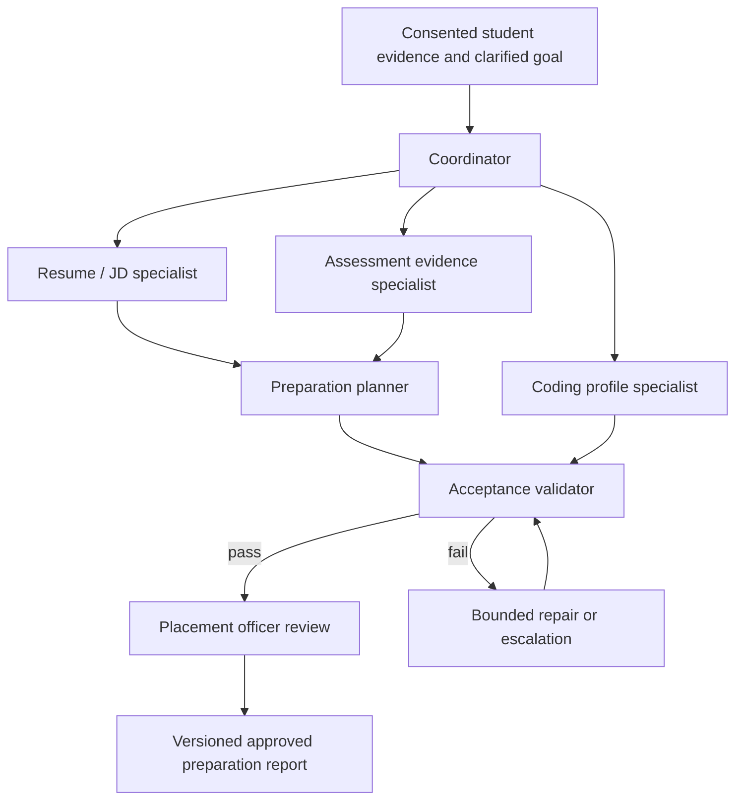

# Worklet 9 Assignments

## Placement Readiness & Career Intelligence Portal — ASCEND

Fourteen original executable lab notebooks apply the agentic-workflow learning sequence to this project's placement-readiness problem statement. They contain objectives, inputs, runnable placement examples, deliberately failing cases, assertions, real portal regression checks, saved execution output and reflection.

| Team member | USN |
| --- | --- |
| Vijay Kumar | 01FE23BCI083 |
| Rishi Kulkarni | 01FE23BCI088 |
| Prajwal Hugar | 01FE23BCI075 |
| Rohit Yendegeri | 01FE23BCI001 |

## Problem statement and approach

Students need a clear connection between their resume, coding activity, target role, JD and preparation weaknesses. ASCEND structures consented evidence, identifies skill gaps, proposes activities and provides assessments/interviews. A placement officer reviews reports before publication. The labs demonstrate how to coordinate that work, use typed tools, retain evidence, recover failures and preserve human authority.

Synthetic students `DEMO001` (backend development) and `DEMO002` (data analytics) are teaching fixtures, not the team members' actual records. No API key, resume, account database or recording from the running portal is included. These notebooks make no live Gemini calls and consume no model quota.

## Lab index

| Lab | Notebook | Main evidence |
| --- | --- | --- |
| 1 | [Planner loop](LAB_01_Worklet9_Planner_Loop.ipynb) | Vague goal → clarification → two revisions; conflicting time budget |
| 2 | [Typed tools](LAB_02_Worklet9_Typed_Tools.ipynb) | Validated skill coverage and marking; reminder stays a draft |
| 3 | [Reusable skills](LAB_03_Worklet9_Reusable_Skills.ipynb) | Same typed analysis/format skills across two roles |
| 4 | [Memory and retrieval](LAB_04_Worklet9_Memory_and_Retrieval.ipynb) | Owner/status/tag filtering and lexical vector similarity |
| 5 | [MCP-style connector](LAB_05_Worklet9_MCP_Connector.ipynb) | JSON/SQLite/API-shaped source substitution and permission checks |
| 6 | [Governed runtime](LAB_06_Worklet9_Governed_Runtime.ipynb) | Crash, fresh runtime resume, budgets and approval gate |
| 7 | [Node graph](LAB_07_Worklet9_Node_Graph.ipynb) | Real specialist trace, dependency diagram and pending human review |
| 8 | [Parallel swarm](LAB_08_Worklet9_Parallel_Swarm.ipynb) | Serial/parallel quality, transient/permanent faults, coverage and version reconciliation |
| 9 | [Evidence grounding](LAB_09_Worklet9_Evidence_Grounding.ipynb) | Source/locator/value validation and rejection of invented claims |
| 10 | [Ops resilience](LAB_10_Worklet9_Ops_Resilience.ipynb) | Minimal citation repair, preservation of good rows and escalation |
| 11 | [SDLC factory](LAB_11_Worklet9_SDLC_Factory.ipynb) | Spec-derived acceptance checks and blocked incomplete drafts |
| 12 | [Safety and governance](LAB_12_Worklet9_Safety_and_Governance.ipynb) | Officer permissions, student privacy, versioning and rollback |
| 13 | [Domain specialists](LAB_13_Worklet9_Domain_Specialists.ipynb) | Seven real role packs and reviewed benchmark expiry regression |
| 14 | [Capstone](LAB_14_Worklet9_Capstone.ipynb) | Integrated synthetic request → validated report → officer publication |

## Run and reproduce

Clone the **whole repository**. Notebooks import shared helpers and production modules; copying just one notebook into Colab is insufficient.

From the repository root:

```bash
python -m pip install -r backend/requirements.txt
python Assignments/run_notebooks.py
python Assignments/run_notebooks.py --check
```

The runner executes each notebook in a fresh Python process, captures actual stdout/errors, and writes output into the `.ipynb`. It supports these plain Python cells without installing Jupyter; it does not claim to run a Jupyter kernel. `--check` verifies executed cells, no error outputs and a matching source hash. Results and measured timings are recorded in [execution_report.json](execution_report.json).

Alternatively, install Jupyter in your environment, open any notebook from the repository, select Python 3 and run all cells. Each notebook can run independently of the others. The assignments need the surrounding project, not the live web server or Docker.

`build_notebooks.py` regenerates notebook **sources and clears their outputs**. Run the execution command afterward to obtain fresh evidence. Do not edit saved outputs manually.

## What is reused and what is educational

- **Actual project functions:** coordinator planning, resume/role analysis, assessment grading, specialist report pipeline and its validator.
- **Actual project tests:** selected HTTP/API tests for MCP scope, durable recovery, targeted repair, batch quality, approval, revisions, rollback and expiry. These create temporary databases.
- **Notebook-only demonstrations:** the small typed-skill wrapper, TF-IDF cosine retrieval, interchangeable JSON/SQLite/API-shaped readers, file-based runtime, identity reconciliation, row-level repair and spec-derived acceptance factory.
- **Website distinctions:** memory currently uses Jaccard similarity, repair operates at stage/dependency level, and validation uses fixed checks. The local `/api/mcp` endpoint is MCP-style; external MCP client interoperability is not claimed. No proprietary OpenClaw integration is claimed.
- **Gemini:** the website uses Gemini for consented plans, personalised practice and interview generation/evaluation. These notebooks demonstrate reproducible orchestration without calling it. Live content quality and camera/audio need the [manual test guide](../docs/FINAL_TEST_GUIDE.md).

## Architecture and approval boundary



The officer is a human reviewer, not a seventh AI agent. Gemini feedback and resume claims are not certified competence or hiring decisions. Parallel timings are reported as measured; a speedup is not presumed.

## Reference and authorship

The requested reference was [Riya Magadum's Worklet 15 Assignments folder](https://github.com/riyamagadum2819/Executive-Decision-Support-System/tree/main/Assignments), inspected at tree `68e1294f1d0b90ba234a9dc8e602e664a2958dee`. Its fourteen-lab organization and learning topics informed the structure. These are newly written Worklet 9 exercises: no executive-decision implementation, institutional dataset, reference execution output or other team's identity was copied.

The requirements mapping is in [the project requirements record](../docs/requirements.md). This submission is executable synthetic lab evidence, not a claim of production deployment or completion of the teacher's live demonstration.
