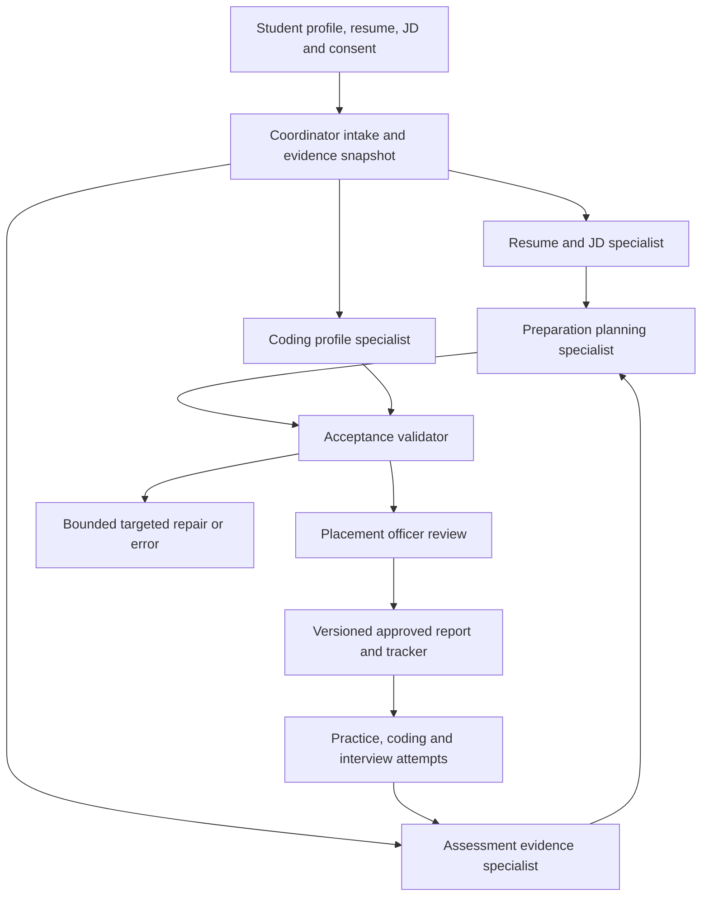

# Placement Readiness & Career Intelligence Portal

**ASCEND** is an agentic, placement-officer-reviewed preparation portal. It combines resume and job-description analysis, public coding profiles, personalised Gemini practice, isolated coding assessments, and camera/microphone mock interviews in one student workspace. Specialist workflows draft preparation reports; validation and officer approval control publication.

## Team Members

**Course assignments:** [Worklet 9 — all 14 executable lab notebooks](Assignments/README.md).

| Name | USN |
| --- | --- |
| Vijay Kumar | 01FE23BCI083 |
| Rishi Kulkarni | 01FE23BCI088 |
| Prajwal Hugar | 01FE23BCI075 |
| Rohit Yendegeri | 01FE23BCI001 |

## Project Overview

Students register using their USN, upload a resume, select a target role and paste a JD. The portal compares evidence with role requirements, imports consented public LeetCode/GitHub information, and generates preparation guidance. Students practise, track learning evidence, and complete a ten-question Gemini interview. Placement officers review reports, progress, assessment results, transcripts and recordings.

The project applies agentic ai concepts through a coordinator, parallel specialists, typed tools, scoped memory, durable checkpoints, bounded repair, acceptance validation and human review. Gemini generates selected content inside this controlled workflow; it does not control authentication, permissions, code execution or publication.

## Problem Statement

- Resume, coding practice and interview feedback are scattered across tools.
- Students need clearer links between their evidence, target role and JD requirements.
- Generic preparation does not reflect individual weaknesses.
- Placement officers need reviewable reports and a record of preparation progress.

## Objectives

- Structure consented student evidence and explain skill gaps.
- Generate personalised activities and practice questions.
- Provide coding execution and spoken mock-interview feedback.
- Preserve officer review, report versions, consent boundaries and audit history.
- Keep calculations reproducible and distinguish AI suggestions from verified achievements.

## Understand the Project in One Minute

A student tells ASCEND **what job they want**, supplies their **resume and JD**, and optionally connects coding profiles. The system identifies evidence gaps and suggests preparation. The placement officer reviews the generated report. The student follows the approved tasks, takes practice tests and attends a spoken mock interview. Results become evidence for the next preparation report.

**Example:** A student wants a backend role requiring Python, SQL, APIs and testing. Their resume mentions Python and SQL, but provides little testing evidence. The report highlights that gap and proposes a practical testing exercise. Technical practice and the interview explore relevant concepts. If the student struggles, a newly generated report can include those weaknesses.

A missing resume keyword means **missing evidence**, not proof that the student lacks the skill. Likewise, completing a tracker task is a student-reported achievement, not an automatically verified qualification.

## Contents

- [Complete journey](#complete-journey-from-start-to-finish)
- [Student features](#student-features)
- [Placement officer features](#placement-officer-features)
- [Interview and scoring](#how-the-interview-and-scoring-work)
- [Gemini responsibilities](#what-gemini-does-and-what-the-backend-does)
- [Six workflow agents](#the-six-workflow-agents)
- [Swarm processing](#how-the-swarm-works)
- [MCP-style tools and memory](#where-mcp-style-tools-and-memory-are-used)
- [Architecture](#system-architecture)
- [Installation](#installation-and-setup)
- [Testing](#tests-and-diagnostics)
- [Assignments](Assignments/README.md)
- [Current limits](#results-and-current-limits)

## Complete Journey: From Start to Finish

| Step | Who acts? | What happens? | What happens next? |
| --- | --- | --- | --- |
| 1 | Officer | Creates the initial officer account and connects Gemini through **Interview scores**. | Student AI features can use the server's saved key. |
| 2 | Student | Registers with a USN and password. | Opens their private workspace. |
| 3 | Student | Saves academic details, target role, JD and consent. | The system has the intended preparation context. |
| 4 | Student | Uploads a resume and checks the extracted sections. | Resume/JD comparison identifies evidenced and missing skills. |
| 5 | Student | Imports LeetCode and optionally GitHub with source consent. | Public coding/project information supplements the resume. |
| 6 | Student | Saves a goal, focus topics and weekly hours in **Preparation planner**. | The coordinator asks for missing information or creates a ready plan. Gemini activities require explicit consent. |
| 7 | Student | Generates a preparation report in **Resume workspace**. | Specialists process the evidence; validation checks the draft. |
| 8 | Officer | Reviews the report and approves it or requests changes. | Approved reports become visible as published preparation guidance. |
| 9 | Student | Works through tasks and records evidence notes. | Officer can inspect preparation progress. |
| 10 | Student | Completes aptitude, technical and coding assessments. | Results and weak topics are saved. |
| 11 | Student + officer | Generates a fresh report and has it reviewed. | Preparation activities incorporate new assessment evidence. |
| 12 | Student | Completes the camera/microphone interview. | Gemini evaluates confirmed answers and the backend saves scores. |
| 13 | Officer | Reviews transcripts, scores, recordings and events; adds notes. | Student uses the feedback to prepare and practise again. |

This is the **recommended sequence**, not a compulsory exam progression. The portal does not require completion of every assessment before an interview. Assessment results do not automatically regenerate a published report: generate a fresh report and obtain officer approval.

The private planner and practice feedback can be shown directly to a student. **Officer approval applies to published preparation reports**, not to every piece of AI output in the portal.

## Student Features

| Feature | Student input/action | Processing and output |
| --- | --- | --- |
| **My profile** | Academic details, target role, JD and consent selections. | Saves the student's preparation context. Academic details remain self-reported. |
| **Resume workspace** | Upload PDF, DOCX or TXT; inspect the extraction; request a report. | Separates personal details, academics, projects and skills. Shows JD matches, missing requirements and project relevance. Starts the specialist report workflow. |
| **Coding & GitHub** | Public LeetCode username and optional GitHub username, with consent. | Imports available activity and public repository information. Reports source failures or stale data; private repositories are not imported. |
| **Preparation planner** | Goal, available weekly hours and difficult topics. | Clarifies incomplete requests and saves plan versions. With AI consent, Gemini generates evidence-based activities and advice. Without it, basic rule planning remains available. |
| **Reports & preparation** | Read published reports and recommendations. | Displays officer-approved evidence coverage, gaps and preparation activities. New drafts wait for review. |
| **Preparation tracker** | Mark tasks not started, in progress or completed; add notes. | Persists student-reported progress for officer viewing. Current and historical report versions retain their own task records. |
| **Practice assessments** | Consent to Gemini context processing; answer aptitude or technical multiple-choice questions. | Generates ten questions per new attempt from resume/role/JD context. The backend enforces a 20-minute timer and marks against the saved AI-generated key. Explanations appear after submission. |
| **Coding assessments** | Write Python, save a draft, run samples and submit. | Executes code in Docker against sample/hidden cases; saves actual test results. Attempts last 30 minutes. Final submission closes the attempt. |
| **Interview studio** | Give consent, allow camera/microphone, answer and review transcripts. | Runs a ten-question Gemini interview with adaptive follow-ups, rubric feedback, scores and private recording. |

### What are evidence notes?

Evidence notes explain what the student actually did for a preparation task. For example:

> Completed ten SQL JOIN exercises. Built INNER JOIN and LEFT JOIN queries, tested missing records, and added the solutions to my project repository.

A student can include an exercise description, repository link, learning outcome or remaining difficulty. Notes do **not** automatically change test scores or prove skill mastery.

### Personalised practice versus coding assessments

- **Aptitude:** Gemini generates quantitative, logical and verbal reasoning questions with role-relevant scenarios.
- **Technical:** Gemini uses the student's resume skills/projects and JD requirements to generate questions.
- **Coding:** the portal supplies predefined Python problems and executes test cases. This is not Gemini grading.

New AI practice requires a saved role, JD, uploaded resume, active resume consent and explicit Gemini processing consent. Existing attempts retain their original questions. Generation failure produces an error rather than a fabricated result. Answer keys are hidden from the active-attempt response until submission; the keys are AI-generated and may still contain factual mistakes.

## Placement Officer Features

The internal role name **faculty** means **placement officer**. There is no separate administrator role in this release.

| Feature | Officer responsibility |
| --- | --- |
| **Submissions** | View student profiles and submitted information within consent rules. |
| **Resume workspace / Coding & GitHub** | Review available student evidence and source information. |
| **Preparation planner** | Inspect students' saved goals and plan versions. |
| **Reports & preparation** | Review evidence and activities, approve a report or request changes. |
| **Preparation tracker** | View task progress and student evidence notes. |
| **Practice assessments** | Review saved aptitude/technical results and feedback. |
| **Coding assessments** | Review submitted code and execution results. |
| **Interview scores** | Configure the shared Gemini key; inspect scores, answers, transcript edits, recordings and review events; save officer notes. |
| **Versions & audit** | Review seven role benchmark packs, create report activity revisions, restore earlier approved publications, and inspect report/run metrics and audit events. |
| **Agent diagnostics** | Inspect stage checkpoints and failures, resume eligible runs, and start multi-student batch analysis. This technical screen is hidden from students. |

An activity revision creates a **new pending report**, preserving the original evidence and numerical scores. It requires approval before becoming current. Rollback changes the current publication pointer; it does not erase history. Expired reviewed benchmark evidence cannot be newly approved or restored through the governed actions.

## How the Interview and Scoring Work

1. **Start:** the student consents to private recording and sending the relevant context/audio to Gemini.
2. **Question generation:** Gemini produces ten questions using consented resume excerpts, JD and target role. Questions cover introduction, projects, technical concepts, teamwork/HR and reflection.
3. **Answer capture:** the student answers the current question using the microphone while the camera preview remains visible.
4. **Transcription and evaluation:** Gemini transcribes the audio and evaluates the answer against the actual question, rubric and available context.
5. **Student review:** the student checks the transcript. Unchanged text reuses the initial evaluation; corrected text is evaluated again. Original and corrected transcripts are retained for review.
6. **Follow-ups:** the next question can adapt after answers 2, 5 and 7. The interview remains ten questions and preserves the HR/reflection rounds.
7. **Scoring:** Gemini returns integer scores from 0 to 4 for **correctness, relevance, clarity and depth**. The backend validates the response and calculates the percentage.
8. **Results:** student and officer see saved answers, feedback and scores. The officer can add review notes without overwriting AI scores.

For `N` scorable answers:

```text
Percentage = 100 × sum of all four rubric scores across answers / (16 × N)
```

Unscorable answers are excluded. Incomplete or partly scorable sessions remain labelled **partial**; they are not represented as a complete interview score. If no answers are scorable, there is no percentage.

**The camera does not grade facial expressions or personality.** Video is stored for private review. Tab switches and camera/microphone interruptions are logged as review signals, not automatic findings of cheating. Failed recording uploads can be retried while the page remains open; unsent browser-memory data does not survive closing or refreshing the page. Explicit recording deletion removes the recording, while interview scores remain.

## What Gemini Does and What the Backend Does

| Function | Gemini | Backend / human |
| --- | --- | --- |
| Resume extraction and JD matching | Not responsible for the deterministic extraction/match percentage | Python extracts text and compares evidence. |
| Preparation planning | Creates personalised activities and advice after consent | Validates gap coverage, saves versions and applies officer review to reports. |
| Aptitude/technical practice | Generates questions, answer keys and explanations | Validates format, starts timers, saves selections and calculates the result. |
| Interview | Generates questions/follow-ups, transcribes audio, evaluates answers and supplies rubric scores | Validates scores, preserves edits, calculates percentages and controls recording access. |
| Coding | No AI grading | Docker executes test cases under resource restrictions. |
| Accounts and permissions | No role | Sessions, password hashing and access checks are backend responsibilities. |
| Publication | Cannot approve its own output | Placement officer approves preparation reports. |

The officer saves **one server-side Gemini key** for the installation. Students cannot retrieve it and do not need individual keys. A successful setup makes a small live request before saving; it does not guarantee future quota or service availability. AI failures are reported, not hidden behind made-up scores.

## The Six Workflow Agents

The main preparation-report pipeline contains **six named automated stages**. Here, “agent” means a specialist responsibility in a controlled workflow—not six independently running LLMs.

| # | Agent / stage | What it reads | What it produces |
| --- | --- | --- | --- |
| 1 | **Coordinator intake** | Student evidence, consent, role and saved plan. | A preparation context for the run; unresolved clarification stops report generation. |
| 2 | **Resume and JD specialist** | Resume text, target-role benchmark and JD. | Structured resume evidence, role coverage, JD comparison and gaps. |
| 3 | **Coding profile specialist** | Consented public LeetCode/GitHub evidence. | Available activity/project information with source status. Runs alongside the resume/JD specialist. |
| 4 | **Assessment evidence specialist** | Saved aptitude, technical and coding assessment results. | Topic weaknesses to consider in preparation. |
| 5 | **Preparation planning specialist** | Role/JD gaps, assessment weaknesses and the selected plan. | Gap-linked activities; Gemini generates personalised activity text when AI planning consent is active. |
| 6 | **Acceptance validator** | The assembled report and resume evidence digest. | Checks for gap coverage, task grounding, evidence references, score bounds and required sections. Failed checks block review/publication. |

**After these six stages, the placement officer supplies human approval.** The officer is not an AI agent. Interview generation/evaluation and practice generation are additional AI-powered services, separate from the six report stages.

### How failures and recovery work

- Stage outputs are saved as checkpoints.
- Completed unrelated work can be reused after an eligible failed/interrupted run.
- Input fingerprints prevent reusing checkpoints when the underlying evidence has changed.
- Runs have a maximum of three attempts. Transient stage failures have a bounded retry, and acceptance failures allow one targeted repair.
- Targeted repair reruns the failing stage and its dependents rather than rebuilding everything.
- Report creation is guarded against duplicate publication. An unrecoverable failure becomes an explicit error for review.

## How the Swarm Works

The project uses two levels of bounded parallel work:

1. **Within one student's report:** resume/JD analysis and coding-profile analysis run concurrently. Their outputs join the preparation and validation workflow.
2. **Across students:** the officer can select up to eight students. Two report workers process students at a time, keeping separate success/failure outcomes.

For example, Student A and Student B can be processed together, followed by C and D. A failure for one student does not automatically discard everyone else's report. Every successful report still needs officer approval.

This is a **coordinated parallel workflow**, not an unrestricted group of LLMs debating decisions. Timings depend on workload; the small local benchmark did not establish a speedup. The assignment notebooks demonstrate additional conflict-resolution examples and label them as teaching extensions.

## Where MCP-Style Tools and Memory Are Used

**MCP stands for Model Context Protocol.** Its purpose is to expose tools and context through a structured interface. This project implements an authenticated **local MCP-style JSON-RPC gateway** at `/api/mcp`, with its contracts in `backend/tool_gateway.py`.

| Tool | Purpose |
| --- | --- |
| `student_evidence` | Reads consented profile, resume, assessment snapshots, saved plan and selected benchmark evidence. |
| `coding_profiles` | Reads available consented public coding-profile information and checks stale accounts/consent. |
| `approved_memory` | Retrieves relevant earlier approved reports belonging to the same student. |

The report runtime uses these named gateway calls. The gateway checks the actor, student scope and active resume consent and records tool calls in the audit trail. Think of it as a **controlled reception desk for evidence**.

Two kinds of memory have different purposes:

- **Run checkpoints:** temporary execution progress used to resume work.
- **Approved report history:** persisted prior outcomes retrieved using same-student lexical Jaccard similarity.

Retrieved history is attached to reports as context; it is not proof that prior activities were completed. This is not a neural vector database. Not every ordinary portal endpoint goes through MCP, and interoperability with external MCP clients has not been verified.

## Technology Stack

| Layer | Technologies |
| --- | --- |
| Backend | Python 3.11+, standard-library HTTP server and modular services |
| Database | SQLite for accounts, attempts, reports, checkpoints and audit records |
| Frontend | HTML, CSS and vanilla JavaScript; no frontend build step |
| AI | Google Gemini REST API with structured output validation |
| Resume extraction | pypdf and Python document-processing utilities |
| Authentication | Server-side sessions, scrypt password hashing and role checks |
| Agent workflow | Custom specialist graph, typed local MCP-style gateway and bounded parallel workers |
| Coding execution | Docker Linux containers with network, filesystem and resource restrictions |
| Testing | Python unittest, Node.js upload tests and JavaScript syntax checks |
| CI | GitHub Actions for Windows and Linux |

## System Architecture



- **Typed tools:** authenticated evidence, coding-profile and approved-memory readers.
- **Memory:** same-student approved report retrieval using lexical similarity.
- **Runtime:** persistent stage checkpoints, input fingerprints, bounded retry/repair and idempotent report publication.
- **Parallelism:** resume/JD and coding analysis execute concurrently; student batches have independent outcomes.
- **Governance:** acceptance checks precede officer review. Report activities can be revised without rewriting original evidence scores.

This is a local MCP-style interface, not a verified general-purpose external MCP host. The deterministic workflow is not an unrestricted autonomous LLM swarm. See [requirements coverage](docs/requirements.md) for implementation boundaries.

## Project Structure

```text
backend/             HTTP server, services, agent workflow and provider integration
  tests/             Unit and HTTP integration tests
frontend/            Student/officer interface and recording upload helper
  tests/             Recording upload tests
scripts/             Startup, verification, diagnostics and source packaging
.github/workflows/   Automated checks
docs/                Requirements and complete demonstration guide
PROGRESS.md          Implementation and verification history
runtime/             Generated locally; ignored by Git
```

## Installation and Setup

### Prerequisites

- Python 3.11 or later (tested with Python 3.12).
- Chrome or Edge and a camera/microphone for the interview.
- Docker Desktop with Linux containers for coding assessments.
- Node.js for JavaScript tests; not required to serve the frontend.
- A Google AI Studio Gemini key with available API access/quota for AI features.

### Run Locally

```bash
git clone https://github.com/VijayKumar-04838/agentic_ai_project.git
cd agentic_ai_project
python -m venv .venv
```

Activate the environment on Windows PowerShell:

```powershell
.\.venv\Scripts\Activate.ps1
```

Or on Linux/macOS:

```bash
source .venv/bin/activate
```

Install dependencies and start the portal:

```bash
python -m pip install -r backend/requirements.txt
python backend/server.py
```

Open **http://localhost:8000**. The same server serves the frontend and API. A fresh database is created automatically.

### Accounts and Gemini

1. Use **Initial placement officer setup** to choose the officer ID and password.
2. Students register their own USN/password accounts. Passwords require at least 12 characters.
3. Officer: open **Interview scores**, paste the Gemini key and click **Save & test connection**.
4. Wait for the connected result. No model selector or restart is required.
5. Students provide explicit consent before their context/audio is sent to Google.

Windows portal keys are encrypted for the current Windows user. On other operating systems, configure `GEMINI_API_KEY` and optionally `GEMINI_MODEL` through environment variables or a local `.env` based on `.env.example`. The Windows key-saving UI requires DPAPI. Never commit keys or `.env` files.

Use separate browser profiles or normal/private windows for simultaneous student and officer sessions. Tabs in the same browser profile share the login cookie.

### Coding Runner

Start Docker Desktop with Linux containers, then run:

```bash
docker pull python:3.12-alpine
```

Student code runs without network access or host mounts, as a non-root user with a read-only root filesystem and CPU, memory, process, output and time limits. The portal does not execute student code directly on the host.

## Quick Demonstration Checklist

1. Student registers, completes profile/JD and uploads a resume.
2. Student imports coding profiles and optionally GitHub.
3. Student saves a preparation goal and consents to Gemini activities if desired.
4. Generate a preparation report; officer reviews and approves it.
5. Student follows tasks and records evidence notes.
6. Complete personalised aptitude/technical practice and Docker coding assessments.
7. Generate a fresh report to incorporate assessment weaknesses.
8. Start a new camera/microphone interview; review each transcript and confirm answers.
9. Student and officer inspect Gemini rubric scores, feedback and recording.
10. Officer adds review notes and reviews further report revisions.

See [the complete test flow](docs/FINAL_TEST_GUIDE.md).

## Tests and Diagnostics

```bash
cd backend
python -m unittest discover -s tests
cd ..
node --check frontend/app.js
node --check frontend/workspaces.js
node --test frontend/tests/media-upload.test.cjs
python scripts/check_release.py
python scripts/doctor.py
```

Windows users can run `scripts/verify.ps1 -PythonPath <path-to-python>` for the supported complete verification flow.

## Common Problems and Solutions

| What you see | What to check |
| --- | --- |
| **localhost refused to connect** | Start `python backend/server.py` from the repository root and keep the process running. The website is available only while the server runs. |
| **Student account required** after opening the officer portal | Tabs in the same browser profile share a session. Use separate browser profiles, normal/private windows, or different browsers; log in again as the student. |
| **Gemini not connected** | Officer opens Interview scores and clicks Save & test connection. Read the inline error beside the key form. A pasted key alone is not saved; the connection check must succeed. |
| **Quota / temporary provider error** | Check the Google AI Studio project's API access and quota. Retry only when the cause is addressed; do not assume the key is invalid from a timeout alone. |
| **Practice cannot start** | Save a target role and nonempty JD, upload a resume, enable resume consent and accept Gemini processing consent. |
| **No approved roadmap** | Generate a preparation report and have the officer approve it. A private planner result alone is not a published report. |
| **Coding runner unavailable** | Start Docker Desktop in Linux-container mode and pull `python:3.12-alpine`. |
| **Camera/microphone unavailable** | Use Chrome or Edge on localhost, allow both permissions, and close other applications using the devices. |
| **Old questions reappear** | Resuming an attempt preserves its questions. A new assessment or interview generates a new set; distinct wording on every request is not guaranteed. |
| **Transcript is incorrect** | Correct it before confirming. Gemini reevaluates edited text; the officer can see the original and correction. |

## Worklet 9 Assignment Notebooks

The [Assignments folder](Assignments/README.md) contains fourteen executable notebooks covering planning, tools, reusable skills, memory, MCP-style connectors, runtime recovery, node graphs, swarms, grounding, repair, acceptance gates, governance, role specialists and the capstone.

Each notebook includes objectives, synthetic examples, assertions, a real portal regression test, saved output and reflection. All fourteen passed local execution and GitHub checks on Windows and Linux. They make no live Gemini calls and must be run within this repository. Notebook-only extensions are explicitly distinguished from deployed website behaviour.

## Results and Current Limits

- The recorded complete backend suite passed **103 tests**; recording-upload tests and frontend syntax checks also passed.
- Live Docker tests covered correct/incorrect solutions, execution limits, blocked network and read-only writes.
- A live Gemini connection check passed on the development installation. Automated provider tests use mocked responses; full live interview/practice quality and browser acceptance still need manual testing.
- Small-fixture batch results matched sequential quality/coverage; no parallel speedup is claimed.
- Scanned-image resume OCR and arbitrary layouts are not guaranteed.
- Tab switches and device interruptions are review signals, not proof of cheating. Facial expressions do not determine scores.
- Source delivery excludes accounts, resumes, recordings, keys and local runtime data.
- This is a **localhost demonstration**, not a production deployment. Public hosting, institutional identity verification, encrypted recording storage and automatic retention policies require further work. Recordings remain until explicitly deleted.
- There is no separate administrator role, recruitment-drive management system, company ranking engine or six-round essay/spoken-English assessment in this release.

## Conclusion

ASCEND connects student evidence, personalised practice and officer-reviewed preparation in one auditable workflow. AI generates questions and advice; validated tools handle storage, calculations and execution, and the placement officer remains responsible for published preparation reports.


