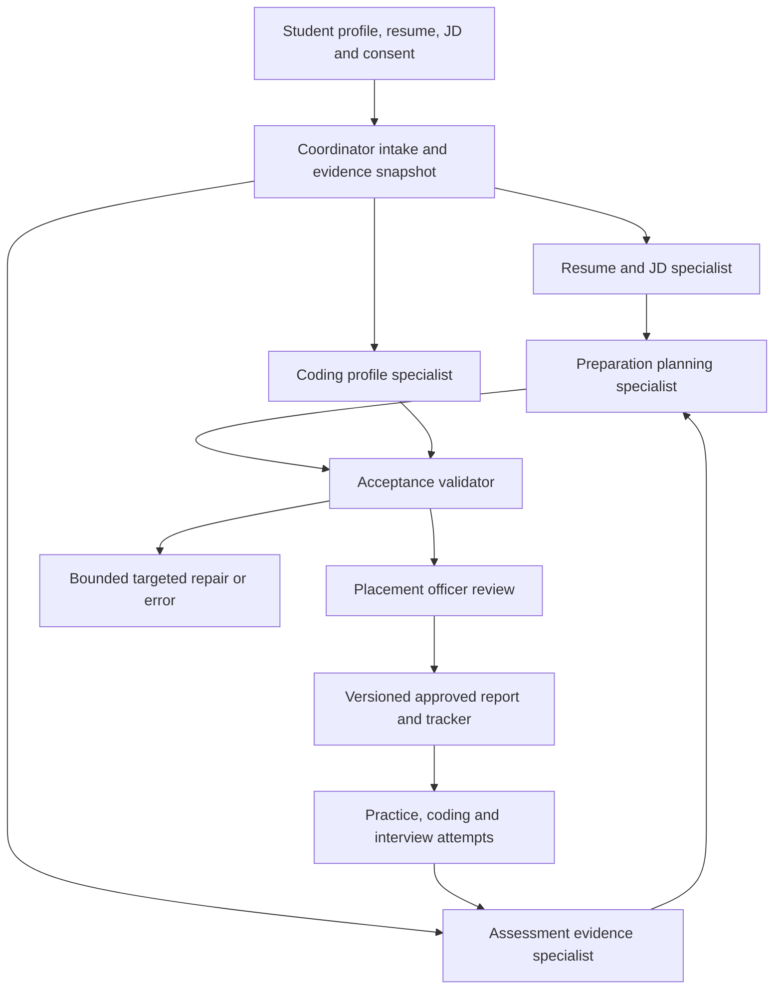

# Placement Readiness & Career Intelligence Portal

**ASCEND** is an agentic, placement-officer-reviewed preparation portal. It combines resume and job-description analysis, public coding profiles, personalised Gemini practice, isolated coding assessments, and camera/microphone mock interviews in one student workspace. Specialist workflows draft preparation reports; validation and officer approval control publication.

## Team Members

| Name | USN |
| --- | --- |
| Vijay Kumar | 01FE23BCI083 |
| Rishi Kulkarni | 01FE23BCI088 |
| Prajwal Hugar | 01FE23BCI075 |
| Rohit Yendegeri | 01FE23BCI001 |

## Project Overview

Students register using their USN, upload a resume, select a target role and paste a JD. The portal compares evidence with role requirements, imports consented public LeetCode/GitHub information, and generates preparation guidance. Students practise, track learning evidence, and complete a ten-question Gemini interview. Placement officers review reports, progress, assessment results, transcripts and recordings.

The project applies agentic ai concepts through a coordinator, parallel specialists, typed tools, scoped memory, durable checkpoints, bounded repair, acceptance validation and human review. Gemini generates selected content inside this controlled workflow; it does not control authentication, permissions, code execution or publication.

## Problem Statement

- Resume, coding practice and interview feedback are scattered across tools.
- Students need clearer links between their evidence, target role and JD requirements.
- Generic preparation does not reflect individual weaknesses.
- Placement officers need reviewable reports and a record of preparation progress.

## Objectives

- Structure consented student evidence and explain skill gaps.
- Generate personalised activities and practice questions.
- Provide coding execution and spoken mock-interview feedback.
- Preserve officer review, report versions, consent boundaries and audit history.
- Keep calculations reproducible and distinguish AI suggestions from verified achievements.

## Key Features

### Student Workspace

- USN/password registration and login; no shipped default password.
- Profile, academic details, target role, JD and source consent.
- PDF, DOCX and TXT resume extraction into personal details, academics, projects and skills.
- JD matching, missing skills and project relevance.
- Public LeetCode import and optional public GitHub information.
- Clarify/plan/revise preparation planner with optional consented Gemini activities.
- Officer-approved reports and a preparation tracker with student-reported evidence notes.
- Gemini-generated aptitude and technical practice: ten questions, 20 minutes, saved attempts and explanations.
- Python coding assessments: saved drafts, sample runs, hidden tests and 30-minute attempts.
- Ten-question camera/microphone interview with Gemini questions, bounded adaptive follow-ups, transcription review, rubric scoring and feedback.
- Private recording playback and explicit deletion after an interview.

### Placement Officer Workspace

- Student submissions, consented evidence, assessment history and preparation progress.
- Report approval or requests for changes; immutable activity revisions and publication rollback.
- Seven role benchmark packs with review sources, versions and expiry.
- Interview scores, original/corrected transcripts, recordings, review events and officer notes.
- Gemini key setup with a live connection check and Windows DPAPI encryption.
- Agent diagnostics, checkpoint recovery and batches of up to eight students with two workers.
- Report/run metrics and audit events.

## Where Gemini Is Used

| Feature | Gemini responsibility | Backend responsibility |
| --- | --- | --- |
| Preparation | Generate evidence-based activities and study advice after consent | Gap coverage, versioning, validation and officer approval |
| Practice assessments | Generate personalised questions, answer keys and explanations | Validate structure, hide keys, enforce timers and mark selections |
| Interview | Generate questions, adaptive follow-ups, transcribe and evaluate answers | Validate responses, preserve transcript edits, calculate percentages and save results |
| Coding | No AI grading | Execute code against test cases in restricted Docker containers |

AI-generated keys, scores and explanations can contain errors. They are practice feedback, not a hiring decision or certified readiness score. Failed generation does not silently become a template result labelled as AI output.

## Technology Stack

| Layer | Technologies |
| --- | --- |
| Backend | Python 3.11+, standard-library HTTP server and modular services |
| Database | SQLite for accounts, attempts, reports, checkpoints and audit records |
| Frontend | HTML, CSS and vanilla JavaScript; no frontend build step |
| AI | Google Gemini REST API with structured output validation |
| Resume extraction | pypdf and Python document-processing utilities |
| Authentication | Server-side sessions, scrypt password hashing and role checks |
| Agent workflow | Custom specialist graph, typed local MCP-style gateway and bounded parallel workers |
| Coding execution | Docker Linux containers with network, filesystem and resource restrictions |
| Testing | Python unittest, Node.js upload tests and JavaScript syntax checks |
| CI | GitHub Actions for Windows and Linux |

## System Architecture



- **Typed tools:** authenticated evidence, coding-profile and approved-memory readers.
- **Memory:** same-student approved report retrieval using lexical similarity.
- **Runtime:** persistent stage checkpoints, input fingerprints, bounded retry/repair and idempotent report publication.
- **Parallelism:** resume/JD and coding analysis execute concurrently; student batches have independent outcomes.
- **Governance:** acceptance checks precede officer review. Report activities can be revised without rewriting original evidence scores.

This is a local MCP-style interface, not a verified general-purpose external MCP host. The deterministic workflow is not an unrestricted autonomous LLM swarm. See [requirements coverage](docs/requirements.md) for implementation boundaries.

## Project Structure

```text
backend/             HTTP server, services, agent workflow and provider integration
  tests/             Unit and HTTP integration tests
frontend/            Student/officer interface and recording upload helper
  tests/             Recording upload tests
scripts/             Startup, verification, diagnostics and source packaging
.github/workflows/   Automated checks
docs/                Requirements and complete demonstration guide
docs/CHANGELOG.md    Implementation and verification history
runtime/             Generated locally; ignored by Git
```

## Installation and Setup

### Prerequisites

- Python 3.11 or later (tested with Python 3.12).
- Chrome or Edge and a camera/microphone for the interview.
- Docker Desktop with Linux containers for coding assessments.
- Node.js for JavaScript tests; not required to serve the frontend.
- A Google AI Studio Gemini key with available API access/quota for AI features.

### Run Locally

```bash
git clone https://github.com/VijayKumar-04838/agentic_ai_project.git
cd agentic_ai_project
python -m venv .venv
```

Activate the environment on Windows PowerShell:

```powershell
.\.venv\Scripts\Activate.ps1
```

Or on Linux/macOS:

```bash
source .venv/bin/activate
```

Install dependencies and start the portal:

```bash
python -m pip install -r backend/requirements.txt
python backend/server.py
```

Open **http://localhost:8000**. The same server serves the frontend and API. A fresh database is created automatically.

### Accounts and Gemini

1. Use **Initial placement officer setup** to choose the officer ID and password.
2. Students register their own USN/password accounts. Passwords require at least 12 characters.
3. Officer: open **Interview scores**, paste the Gemini key and click **Save & test connection**.
4. Wait for the connected result. No model selector or restart is required.
5. Students provide explicit consent before their context/audio is sent to Google.

Windows portal keys are encrypted for the current Windows user. On other operating systems, configure `GEMINI_API_KEY` and optionally `GEMINI_MODEL` through environment variables or a local `.env` based on `.env.example`. The Windows key-saving UI requires DPAPI. Never commit keys or `.env` files.

Use separate browser profiles or normal/private windows for simultaneous student and officer sessions. Tabs in the same browser profile share the login cookie.

### Coding Runner

Start Docker Desktop with Linux containers, then run:

```bash
docker pull python:3.12-alpine
```

Student code runs without network access or host mounts, as a non-root user with a read-only root filesystem and CPU, memory, process, output and time limits. The portal does not execute student code directly on the host.

## End-to-End Demonstration

1. Student registers, completes profile/JD and uploads a resume.
2. Student imports coding profiles and optionally GitHub.
3. Student saves a preparation goal and consents to Gemini activities if desired.
4. Generate a preparation report; officer reviews and approves it.
5. Student follows tasks and records evidence notes.
6. Complete personalised aptitude/technical practice and Docker coding assessments.
7. Generate a fresh report to incorporate assessment weaknesses.
8. Start a new camera/microphone interview; review each transcript and confirm answers.
9. Student and officer inspect Gemini rubric scores, feedback and recording.
10. Officer adds review notes and reviews further report revisions.

See [the complete test flow](docs/FINAL_TEST_GUIDE.md).

## Tests and Diagnostics

```bash
cd backend
python -m unittest discover -s tests
cd ..
node --check frontend/app.js
node --check frontend/workspaces.js
node --test frontend/tests/media-upload.test.cjs
python scripts/check_release.py
python scripts/doctor.py
```

Windows users can run `scripts/verify.ps1 -PythonPath <path-to-python>` for the supported complete verification flow.

## Results and Current Limits

- The recorded complete backend suite passed **103 tests**; recording-upload tests and frontend syntax checks also passed.
- Live Docker tests covered correct/incorrect solutions, execution limits, blocked network and read-only writes.
- A live Gemini connection check passed on the development installation. Automated provider tests use mocked responses; full live interview/practice quality and browser acceptance still need manual testing.
- Small-fixture batch results matched sequential quality/coverage; no parallel speedup is claimed.
- Scanned-image resume OCR and arbitrary layouts are not guaranteed.
- Tab switches and device interruptions are review signals, not proof of cheating. Facial expressions do not determine scores.
- Source delivery excludes accounts, resumes, recordings, keys and local runtime data.
- This is a **localhost demonstration**, not a production deployment. Public hosting, institutional identity verification, encrypted recording storage and automatic retention policies require further work. Recordings remain until explicitly deleted.
- There is no separate administrator role, recruitment-drive management system, company ranking engine or six-round essay/spoken-English assessment in this release.

## Conclusion

ASCEND connects student evidence, personalised practice and officer-reviewed preparation in one auditable workflow. AI generates questions and advice; validated tools handle storage, calculations and execution, and the placement officer remains responsible for published preparation reports.


